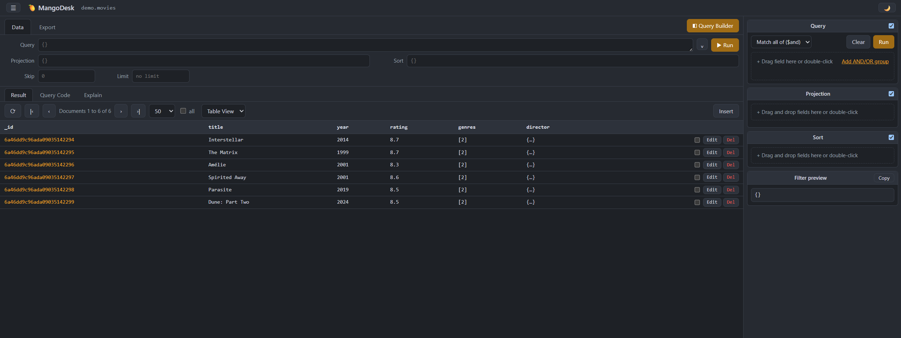
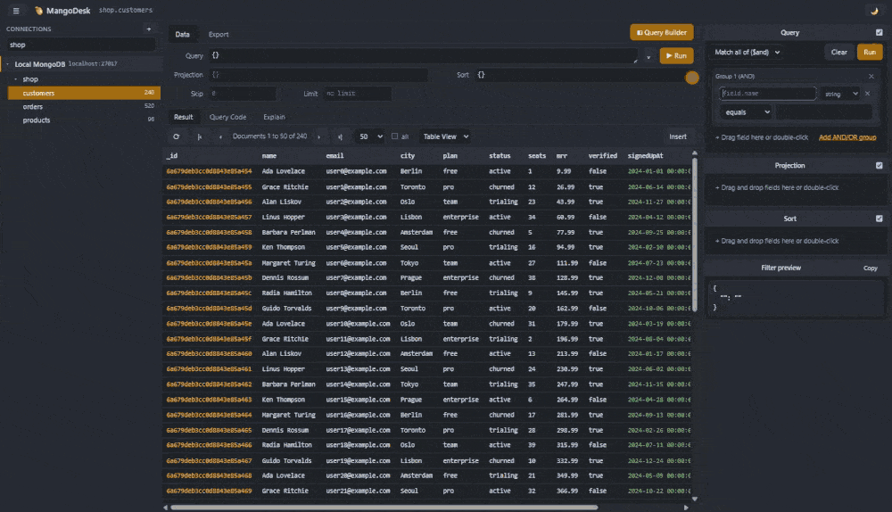

# 🥭 MangoDesk

[](https://github.com/row2002/mangodesk/actions/workflows/ci.yml)
[](https://github.com/row2002/mangodesk/releases/latest)
[](LICENSE)

Free Studio 3T-style MongoDB GUI. Local web app: Node + Express + the official
`mongodb` driver, vanilla-JS frontend, no build step.

**[Download for Windows / macOS / Linux](https://github.com/row2002/mangodesk/releases/latest)**
· or `npx mangodesk`



Build a filter without writing JSON — condition, sort, Run:



## Why not Compass?

Compass is free, official and good. Reach for MangoDesk when one of these
matters:

- **A visual query builder.** Compass has no drag-and-drop condition builder —
  you write the filter as JSON, or ask its AI to write it for you. MangoDesk
  gives you AND/OR groups, type-aware operators and drag-to-sort strips, the
  Studio 3T idea, and shows the filter it produces so you can copy it out.
- **Nothing to install.** One ~40 MB download (no Node.js needed), or one `npx`
  command if you have Node; either way it opens in the browser you already have.
  Compass is a 169 MB Electron download per machine. On a jump host, MangoDesk is
  one SSH tunnel away; a desktop app isn't.
- **A licence you can actually fork.** MangoDesk is MIT. Compass is source
  available under the SSPL.

**Use Compass instead** if you need the aggregation pipeline builder, schema
analysis, embedded `mongosh`, Atlas integration or AI-generated queries.
MangoDesk has none of those and isn't trying to.

## Run

### Download (recommended)

Get the archive for your system from the
[latest release](https://github.com/row2002/mangodesk/releases/latest), unpack it and
start `mangodesk` (`mangodesk.exe` on Windows). No Node.js needed.

| System | File |
|---|---|
| Windows 10/11, x64 | `mangodesk-v0.3.0-win-x64.zip` |
| macOS, Apple Silicon | `mangodesk-v0.3.0-macos-arm64.tar.gz` |
| macOS, Intel | `mangodesk-v0.3.0-macos-x64.tar.gz` |
| Linux, x64 | `mangodesk-v0.3.0-linux-x64.tar.gz` |
| Linux, arm64 | `mangodesk-v0.3.0-linux-arm64.tar.gz` |

It opens http://localhost:27080 in your default browser. The terminal window *is*
the server: keep it open while you work; Ctrl+C (or closing the window) stops
MangoDesk. Every release has a `SHA256SUMS.txt`
(`sha256sum -c SHA256SUMS.txt --ignore-missing`; on macOS `shasum -a 256 -c …`).

The binaries are not code-signed, so the first launch needs one extra step:

- **macOS** — Gatekeeper blocks downloaded unsigned apps. In Terminal, in the
  unpacked folder: `xattr -c ./mangodesk && ./mangodesk`. Or
  try to open it once, then go to **System Settings › Privacy & Security** and click
  **Open Anyway**.
- **Windows** — extract the zip first. If SmartScreen says "Windows protected your
  PC", click **More info › Run anyway**. The console window that opens is the
  server: closing it stops MangoDesk.
- **Linux** — `chmod +x mangodesk && ./mangodesk` if the execute bit got lost. Needs
  glibc 2.28 or newer (Debian 10, Ubuntu 18.10, RHEL 8 and later); musl distros such
  as Alpine are not supported — use the Node.js install there.

### With Node.js

Node 22 or newer:

```
npx mangodesk
```

This runs the latest release from npm (`npx mangodesk@0.3.0` pins one). The
current `main` straight from GitHub: `npx github:row2002/mangodesk`.

### From source

```
git clone https://github.com/row2002/mangodesk
cd mangodesk
npm install
npm start                # flags go after --:  npm start -- --port 9000
```

### Command line

```
mangodesk [--port N | -p N] [--no-open] [--version | -v] [--help | -h]
```

| Environment | |
|---|---|
| `PORT` | port to listen on (same as `--port`) |
| `MANGODESK_NO_OPEN=1` | don't open the browser (also off when `CI` is set, or on Linux without `DISPLAY` / `WAYLAND_DISPLAY`) |
| `MANGODESK_CONFIG=<path>` | connections file to use instead of the default below |

The default port is 27080. If another program has it, MangoDesk tries the next ten;
if MangoDesk itself is already running there with the same connections file, a
second launch just opens that one and exits (one using another file counts as
another program). A port given with `--port` / `PORT` is used as is or not at all.

On start it prints the URL, the connections file in use and how to stop it.

### Where connections are stored

One JSON file, shown on start, in the connection form and in the `?` help dialog:

1. `MANGODESK_CONFIG`, if set;
2. else `connections.json` next to the executable (release binaries) or in the
   source folder (clones), **if that file already exists** — portable mode: put an
   empty `[]` file there to keep connections on a USB stick with the binary;
3. else `~/.mangodesk.json` (Windows: `%USERPROFILE%\.mangodesk.json`).

## Features

- **Connections** — first-run welcome with one-click "Connect to localhost:27017";
  settings form (host or replica-set host list, port, `mongodb+srv://`, user/password,
  auth DB, TLS, extra options) or a raw connection string, switching between the two
  without losing what you typed; test-before-save with plain-language errors
  ("Nothing is listening on … — is MongoDB running?"). A colour tag per connection
  (e.g. red for production) shows as a stripe on the top bar while it is active.
- **Data browser** — sidebar with a connection → databases → collections tree
  (document counts that refresh after writes, keyboard navigation) and a filter box;
  Table / Tree / JSON views; pagination, column-click sorting, resizable columns and
  panels; insert / edit / delete documents; row selection with bulk delete;
  right-click to copy a value, a field name or the document, or to **filter by /
  exclude this value**. Every collection has a URL (`#/connection/db/collection`):
  bookmark it, share it with yourself, use Back / Forward.
- **Management** — right-click the sidebar tree to create a database (with its first
  collection), create / rename / clear / drop a collection, or drop a database. Drops
  ask you to type the name first; clearing empties a collection but keeps it and its
  indexes. `admin`, `config` and `local` can't be dropped from here.
- **Queries** — the query bar takes mongo-shell syntax, not just strict JSON:
  unquoted keys, `ObjectId("…")`, `ISODate("…")`, `NumberLong("…")`,
  `NumberDecimal("…")`, `/regex/i` and trailing commas. Multi-line input,
  recent-query history, per-collection recall of filter / projection / sort / skip /
  limit. Queries that can't be counted (`$near`, `$where`) still page, with "total
  unknown". The Query Code tab gives the query as `mongosh` code that actually runs.
- **Exact BSON types** — values are shown and edited in mongosh syntax and go back
  with the type they came with: Int32 stays Int32, `1.0` stays a Double, Long stays
  Long (even past 2^53), Decimal128 stays Decimal128.
- **Editing** — inline cell editors typed per BSON kind (bare ObjectId hex, unquoted
  strings, boolean select, native date picker); an inline edit updates only that
  field, so fields hidden by a projection are left alone. **Undo** on every edit and
  every delete, single or bulk. Documents without `_id` are read-only rather than
  half-written.
- **Explain** — query planner verdict (`COLLSCAN` is called out, including SBE and
  sharded plans), the collection's indexes, and the winning plan. Create an index
  right there (keys in mongosh syntax, `{ email: 1, at: -1 }`; unique, sparse, TTL,
  name) or drop one, and the plan re-runs against it.
- **Query Builder** — drag fields from the grid into AND/OR condition groups;
  type-aware operators and value inputs (ObjectId, date, number, long, decimal,
  boolean, null); dates match the exact instant; drag-to-sort and drag-to-projection
  strips; live filter preview; state is kept per collection; Run sends the query to
  the Data tab.
- **Export** — current query results as JSON array, NDJSON (both canonical Extended
  JSON, which `mongoimport` reads back losslessly) or CSV (streamed, every column
  found in the result). CSV renders BSON scalars as plain values (`12.34`, not
  `{"$numberDecimal":"12.34"}`) and has an Excel mode: UTF-8 BOM, `;` separator,
  CRLF. A failing export shows the error instead of downloading an empty file.
- **Shell** — light and dark themes (follows the OS by default), keyboard shortcuts
  (`?` lists them: `Ctrl+Enter` run, `Ctrl+F` filter, `Alt+←/→` paging, `Esc`
  close), visible focus rings, version in the top bar, a banner when the server has
  stopped that clears itself once it is back.

## Security

MangoDesk is a local tool with no login: whoever can reach its port can read your
saved connection strings and do anything those users can do in the database.

- The server listens on **127.0.0.1 only**, never on the network.
- It refuses requests whose `Host` is not `localhost` / `127.0.0.1` / `[::1]`
  (DNS rebinding), and writes coming from any other web page (CSRF, including
  form posts). Any port is fine, so SSH tunnels keep working.
- The connections file holds **passwords in plain text**. It is written atomically
  and owner-only (mode 0600) on macOS and Linux; on Windows it gets your profile
  folder's permissions. Prefer database users with only the rights you need, and keep
  the disk encrypted.
- On a shared machine other local users can reach 127.0.0.1 too — don't leave
  MangoDesk running on a multi-user jump host.

Found a vulnerability? See [SECURITY.md](SECURITY.md).

## Troubleshooting

- **"Port 27080 is in use by another program"** — only with an explicit `--port` /
  `PORT`; pick another: `mangodesk --port 27081`. Without one MangoDesk moves to the
  next free port by itself (and says so). Settings and query history are kept per
  port by the browser, so a different port starts with a fresh history.
- **The browser didn't open** — open the URL it printed. It doesn't try when `CI` or
  `MANGODESK_NO_OPEN` is set, with `--no-open`, or on Linux without a display (e.g.
  over SSH).
- **Remote server or jump host** — run MangoDesk there and tunnel to it:
  `ssh -L 27080:127.0.0.1:27080 host`, then open http://localhost:27080. Don't try to
  expose it on 0.0.0.0.
- **macOS: "mangodesk is damaged" / "cannot be verified"** — that is the quarantine
  flag on an unsigned download, not a broken file:
  `xattr -d com.apple.quarantine ./mangodesk`.
- **Connection times out** (after 4–5 s) — check host, port and the TLS setting; for
  Atlas add your IP to the Network Access list; for a replica set reached through a
  tunnel add `directConnection=true` to the options; if the user lives in another
  database set Auth DB.
- **"The connections file … is unreadable"** — the JSON is broken. MangoDesk never
  overwrites it: fix it in a text editor, or move it aside to start empty, then
  reload.
- **Kerberos (GSSAPI), MONGODB-AWS / GCP auth, zstd or snappy compression, SOCKS5
  proxies, client-side field level encryption** — not available in the release
  binaries (they need native or optional driver packages). Use the Node.js install
  and add the package the driver asks for (e.g. `npm install kerberos` in a clone).

## Upgrading

- **Binary** — download the new archive and replace the old `mangodesk`. In portable
  mode, move your `connections.json` next to the new one.
- **npx** — `npx mangodesk@latest` fetches the newest release (plain `npx mangodesk`
  may reuse a cached one); with a pinned version, change the version.
- **Clone** — `git pull && npm install`.

Connections live outside the app (see above) and are kept.

## Uninstalling

Delete the unpacked folder (or the clone), then the connections file —
`~/.mangodesk.json`, or `connections.json` in portable mode. npx keeps its copy in
`~/.npm/_npx` (Windows: `%LocalAppData%\npm-cache\_npx`); delete that folder to
remove it too.

## No local MongoDB?

```
docker run -d --name mangodesk-test -p 27017:27017 mongo:7
```

then connect to `mongodb://localhost:27017`.

## Building binaries yourself

```
npm install
npm run build:sea        # -> dist/mangodesk (dist/mangodesk.exe on Windows)
```

Uses Node's [single executable applications](https://nodejs.org/api/single-executable-applications.html):
the server is bundled with esbuild, `public/` is embedded as assets, and the result is
a copy of the `node` that ran the build — so build on each target OS/arch, with the
Node version you want to ship (22 or newer; releases use Node 24). On macOS the
binary is ad-hoc signed with `codesign`.

## Releasing

1. Bump the version: `npm version 0.3.0 --no-git-tag-version` (package.json and
   the lockfile).
2. Add a `## [0.3.0] - YYYY-MM-DD` section to [CHANGELOG.md](CHANGELOG.md).
3. Commit, then push a tag: `git tag v0.3.0 && git push origin main v0.3.0`.

[`release.yml`](.github/workflows/release.yml) then runs the tests, builds and
smoke-tests the five binaries on native runners, and attaches them with
`SHA256SUMS.txt` to the GitHub release for the tag, using that CHANGELOG section as
the release notes. "Run workflow" with an existing tag (v0.2.0 or later) re-builds
and re-uploads its binaries. If an `NPM_TOKEN` secret is set it also publishes to npm.

## Tests

```
npm test
MANGODESK_TEST_MONGO=mongodb://127.0.0.1:27017 npm test   # plus the integration tests
```

Unit tests cover the CLI, the connections store, the Host/Origin guard, EJSON round
trips, the mongosh printer/parser and the CSV helpers; the integration tests run the
API against a real MongoDB and are skipped when `MANGODESK_TEST_MONGO` is unset. CI
runs them on Linux, macOS and Windows with Node 22, 24 and 26, plus a build and smoke
test of the Linux binary.

## License

MIT — see [LICENSE](LICENSE).
